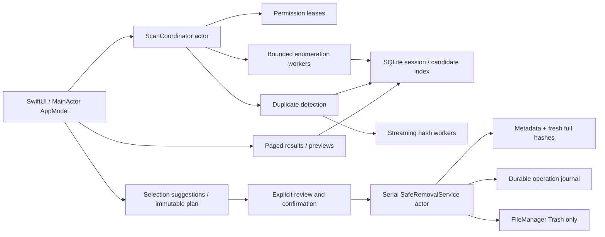

> Design baseline from Astra. For the implemented behavior, measured validation and current deviations, see [Implementation Status](Documentation/IMPLEMENTATION_STATUS.md).

# Architecture

## Decisions

Use a SwiftUI macOS application with AppKit bridges for folder selection, Finder actions, Quick Look, and native previews. macOS 14 is the minimum because NavigationSplitView, inspector APIs and modern SwiftUI state observation are available without compatibility wrappers. Swift 6 strict concurrency is enabled. Installed command-line tools are Swift 6.1.2 with macOS 15.5 SDK; full Xcode is absent. Use Xcode 16+ for Swift 6 and Swift Testing support. No third-party runtime dependencies or generated project tooling are required.

Two production modules: **DuplicateFinderApp** (the Xcode app target is named DuplicateFinder) and **DuplicateFinderCore** (framework/library). Core imports only Foundation today. Domain, Services and Persistence are directories, not extra frameworks. UI depends on Core; Core cannot depend on UI. Tests import Core. Both the real .xcodeproj and Package.swift reference the same Swift sources.

Composition occurs in AppDependencies.architectureBuild(). It injects explicit unavailable scanner, volume, selection and removal implementations. The UI never constructs real filesystem services. A later production factory will create shared actors/adapters and inject them. Never replace unimplemented functionality with fake successful data.

## Ownership and flow

AppModel owns navigation, a bounded visible page, selected IDs, view preferences, presentation errors and a scan-observation Task. It is MainActor-isolated; no enumeration, image decoding, hashing or synchronous database work belongs there. The current folder picker is a short native modal interaction. Folder validation currently queries only directory metadata; future bulk drops must move even that work off MainActor.

ScanCoordinator owns one active scan, state transitions, resource leases, worker lifetimes, bounded issue/progress delivery, cancellation, and completion. Starting while active throws a typed busy error in the real implementation. Progress is a projection of counters; it is never the authority for result validity. App shutdown cancels and releases access before closing; interrupted sessions reconcile on next launch. ResultsChanged is an invalidation signal, not an array of all groups.

Services are Sendable protocols. UI-bound AppKit objects never cross actor boundaries. HashResult contains before/after metadata for validation. FileIdentity combines volume and stable resource identity; path is display/access metadata. FileSnapshot includes logical size, allocated size when known, link count, modification and metadata-change dates. The implementation must retain high-resolution stat timestamps internally where Foundation Date cannot safely encode filesystem granularity. No ID is assumed stable after unmount/reformat.

## Concurrency and bounded work

Use a utility OperationQueue or bounded DispatchQueue adapter for synchronous POSIX/Foundation I/O. Wrapping blocking work in Task.detached alone does not create a safe bounded I/O pool. Start with 2 concurrent hash jobs on SSD, 1 per rotating/removable device; tune through measurement. Suggested read chunk 1 MiB, configurable internally; CryptoKit SHA256.update streams chunks. Cancellation checks before opening, between chunks, after each stage and before committing results. Keep buffers per worker; never use Data(contentsOf:) for full-file hashing.

Protocols expose AsyncThrowingStream for enumeration and scan events. Construct enumeration as a pull-driven unfolding stream or a bounded producer that suspends when full. AsyncStream bufferingNewest/Oldest alone drops data and is prohibited for file events. Persist all issues before presenting a sampled/paged list. Progress may be coalesced to 5–10 Hz; terminal state must not be dropped. Pause gates producers and workers at chunk boundaries, waits for acknowledgements, and keeps existing permissions until resume/cancel. No busy loops or one Task per file.

SQLite access is serialized by a store actor; blocking transactions use a dedicated serial executor/queue. Batch metadata inserts (initially 500), index size/identity/category/digest, and use transactions. CandidateIndex exposes paged size candidates and verified hash writes; full-digest grouping happens in indexed SQL, not a global Swift dictionary. UI queries return summaries (100 rows initially) and separately paged group members (100 rows). A single group containing millions of files must not be loaded into DuplicateGroup just to draw a row. DuplicateGroup is a validated, bounded review/detail value. Removal review initially caps batches at 1,000 candidate files plus necessary keepers; keep the rest in the store. Deep scrolling must migrate ResultQuery offset to an opaque keyset cursor when profiling warrants it; member and candidate paging already have cursors.

## Detection algorithm

1. Resolve roots, acquire grants, normalize and deduplicate physical roots, apply exclusions and selected mount boundaries. Do not follow links or packages. Read metadata without hydration, collecting explicit ScanIssue records for skips/errors.
2. Store regular-file records with identity and snapshots. Collapse hard-link aliases by (volume, resource); retain all alias paths in a separate table for explanation. nlink > 1 files are not counted as independently reclaimable. Conservatively exclude them from V1 removal suggestions even if only one alias was encountered.
3. SQL size grouping selects buckets with at least two distinct physical identities. Optionally compute fingerprints (size plus bounded first/last blocks, including block offsets) to eliminate mismatches. Fingerprint equality never creates groups.
4. Open candidates with no-follow semantics, validate opened descriptor identity, stream SHA-256, fstat before/after and compare against enumeration snapshot. A changed file is invalidated and skipped, not silently accepted with a new digest. Recheck cancellation before storing results.
5. Group equal size/full digest with distinct identities. Persist verification revision. Validate every materialized DuplicateGroup; typed construction rejects mismatching/unverified members and overflow. Hash equality is the exact-duplicate criterion specified for V1, not a claim of mathematical impossibility of cryptographic collisions.
6. Revalidate candidates AND retained copies during removal. Cached scan digests never authorize filesystem mutation. History results are informational until refreshed.

## Persistence

Choose system SQLite3 for scan metadata, candidate indexes, result membership, history and removal journal. A million-file workload and indexed size/hash joins justify a disk-backed relational store; avoid loading Codable arrays or introducing a SwiftData object graph for every file. No external SQLite wrapper is required initially. Schema versioning and migrations are mandatory. Suggested tables: sessions, roots, files, aliases, fingerprints, exact_groups, group_members, issues, removal_operations, removal_events. Files have UNIQUE(session_id, volume_id, resource_id), indexes on session/size, session/digest/size, and result sort keys. Avoid raw SQL in UI/services: implement ScanRepository, CandidateIndex and RemovalJournal against one store actor.

Use SQLite WAL for ordinary scan writes; durable removal journal commits use an explicitly verified durability policy (e.g. synchronous FULL with checked commit), before the OS Trash call. Database failure stops removal before the next operation. Cross-resource atomicity with the filesystem is impossible: an intent without a confirmed result is “needs review,” never blindly retried on startup. Store original path, identity, snapshot, digest, intended keeper identities, operation ID, result, resulting Trash URL and timestamps; enrich the journal schema beyond its transport DTO for these fields.

Use UserDefaults for small viewing settings; a versioned atomic Codable preferences file in Application Support for filters, exclusions, and security-scoped bookmarks is adequate. PreferencesRepository hides storage. Keep scan data and journals local, with user-controlled history clearing; redact paths in general logs. Saved locations are app-scoped bookmarks plus user labels. Refresh stale bookmarks only with valid consent; no path-string fallback for denied access. Keep permission leases balanced across scan and removal separately. Initial skeleton persistence is interfaces only, including the settings UI.

## Permissions and distribution

V1: signed Developer ID distribution, hardened runtime, notarization and stapling; no App Sandbox, no helper daemon, no root elevation, no network entitlements. Base.xcconfig explicitly sets ENABLE_APP_SANDBOX=NO; empty entitlements are intentional. The sample bundle ID must be replaced with the developer’s identifier before signing. Unsandboxed does not mean unrestricted: TCC, POSIX/ACL permissions, SIP and protected locations still apply. Default This Mac roots are current-user locations, never a crawl of /.

Folder picker consent, per-path access attempts, stored bookmarks, and clear errors are the access model. Do not interrogate the TCC database, fabricate a Full Disk Access status, or request an entitlement that bypasses privacy. Explain the manual System Settings route when a protected user location fails. Keep app-owned storage out of scans. Volumes can disappear or become read-only at any stage; invalidate affected work and preserve issues.

A future Mac App Store edition needs a distinct sandboxed build configuration with user-selected read/write and app-scoped bookmark entitlements. Its “This Mac” entry must be restricted to explicitly granted roots and copy changed accordingly. Full Disk Access does not remove App Sandbox restrictions. Do not simply flip ENABLE_APP_SANDBOX while keeping current promises.

Apple references: [App Sandbox file access](https://developer.apple.com/documentation/security/accessing-files-from-the-macos-app-sandbox), [security-scoped bookmark access](https://developer.apple.com/documentation/professional-video-applications/enabling-security-scoped-bookmark-and-url-access), and [FileManager Trash API](https://developer.apple.com/documentation/foundation/filemanager/trashitem(at:resultingitemurl:)). These establish OS API behavior; they are not evidence that this skeleton implements it.

## Safe removal protocol

SelectionService suggests IDs and builds an immutable RemovalPlan from current verified groups. Core validates IDs, independent identities, no all-copy selection, nonnegative group sizes, and checked arithmetic. It does not validate the live filesystem. The service must reject stale revision, inaccessible keeper, nlink > 1 candidate, protected package/path, missing authorization or unsupported Trash behavior before review is enabled.

SafeRemovalService serializes all mutation within the app. For every group/batch:

1. Acquire fresh access leases; resolve only expected local identities and paths. Freeze that group's selection in UI. Confirm plan revision and explicitly selected paths.
2. Reopen keeper and candidates with no-follow semantics; verify identity, size, timestamps, link count and full contents against the expected digest. Confirm at least one readable, independent, non-selected keeper still exists at its expected path.
3. Immediately before EACH Trash call, recheck candidate and keeper metadata/path identity, cancellation, mount availability, protected boundaries and containment. If any changed, skip the affected group and require a new review; never choose another keeper silently.
4. Durably commit operation intent. Invoke only FileManager.trashItem(at:resultingItemURL:). A thrown error is a failure/skip, never permission for removeItem/unlink, shell rm, or another deletion mechanism.
5. Record the OS outcome and returned URL durably. If post-operation journaling fails, halt remaining work and report an uncertain operation for reconciliation. Cancel stops remaining work, not an already completed Trash call.

No public URL-based Trash API provides atomic descriptor-conditional deletion with retained-copy verification. External processes can race between verification and movement. Do not claim race-free protection; document this limitation, recheck immediately, use NSFileCoordinator where cooperating document providers apply, monitor/invalidate known changes, and refuse ambiguous/replaced paths. A held keeper file descriptor alone is not a retained user-visible pathname. Aggressive concurrent file mutation is outside safe-operation conditions and must cause skips when detected. Ordinary files are the supported scope, not actively managed catalogs.

Do not probe Trash by moving user data. A platform adapter may expose unknown/supported/unsupported eligibility based on volume/provider information; “unknown” must not be presented as guaranteed recoverability. The actual OS result remains authoritative. External and network filesystems require real integration testing. An operation log is not an undo facility.

## Storage accounting

Show logical redundant bytes, with an explicit estimate qualifier. Allocated bytes are optional diagnostic metadata; neither logical nor allocated sizes prove exclusive ownership of APFS extents. APFS clones, snapshots, compression, sparse files, hard links and delayed reclaiming break simple sums. Never infer physical bytes freed from moved-file sizes. Record observed free-space deltas only as observations influenced by unrelated system activity.
